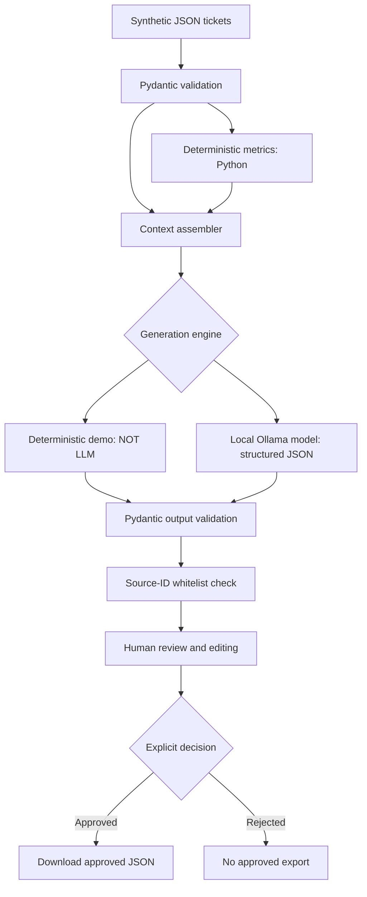

# Architecture and control boundaries

## Trust boundaries

- Ticket content is untrusted data, including any text that resembles an instruction.
- Model outputs are drafts. JSON shape and referenced ticket IDs are checked; narrative factuality is **not** guaranteed.
- Metric counts, severity distribution, and overdue calculations are computed in Python.
- The application only allows HTTP calls to `localhost` or `127.0.0.1` at a specified port.
- The demo does not access real Jira, Confluence, cloud systems or customer systems.
- The example records are invented and do not represent a financial institution's internal risk data.
- Review decisions are held in Streamlit session memory and can be exported with the approved artifact. No secure identity proof, persistent audit trail or role-based access control is implemented.
- There are no automated changes, escalations, account actions, or risk acceptance decisions.

## Known limitations

1. Local LLMs may produce unsupported details despite schema validation and instructions.
2. Unknown IDs matching the `ICT-000` convention are rejected, but semantically false narrative claims cannot reliably be detected automatically.
3. Knowledge-base procedures are generic *drafts*, not approved enterprise instructions.
4. Synthetic examples do not quantify real-world risk or model accuracy.
5. The local Ollama API should not be exposed on an untrusted network.
6. For any deployment beyond a personal demonstration, add authentication, authorization, secure audit logging, data handling rules, evaluated prompting, model monitoring and organizational review.
